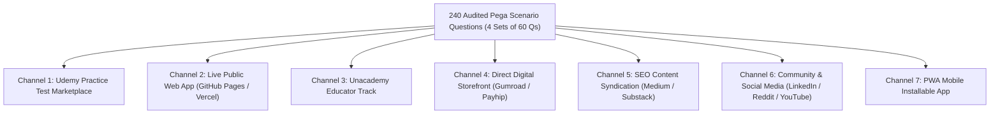

# Global Distribution & Internet Publishing Masterplan
> **Mission Objective**: Publish, distribute, and monetize the 240 Pega scenario questions and practice exam engine across every major educational, web, and professional platform on the internet.

---

## Strategic Distribution Overview



---

## Channel 1: Udemy Practice Test Marketplace (Highest Immediate ROI)

### Why Udemy First?
- Udemy has the largest global audience searching specifically for keywords like `"Pega CSA"`, `"Pega practice test"`, and `"Pega certification questions"`.
- Udemy has a dedicated **Practice Test** course type (no video lectures required).
- Automated payment processing, global currency conversion, and customer support handled by Udemy.

### Course Architecture
- **Course Title**: *Pega Certified System Architect (CSA) Practice Exams 2026: 4 Full Mock Tests*
- **Course Subtitle**: *240 High-Yield Scenario-Based Questions with 3-Attempt Rationale & Architectural Explanations (65% Passing Target)*
- **Format**: 4 Practice Tests (60 Questions each, 90 minutes each, 65% passing threshold).
- **Ready Assets**:
  - `udemy_exports/udemy_practice_exam_set_1.csv`
  - `udemy_exports/udemy_practice_exam_set_2.csv`
  - `udemy_exports/udemy_practice_exam_set_3.csv`
  - `udemy_exports/udemy_practice_exam_set_4.csv`

### Course Landing Page Copy Template
```markdown
### What you'll learn:
- Master 240 realistic Pega scenario-based questions covering all 21 exam domains.
- Practice in simulated real exam conditions (60 questions in 90 minutes, 65% passing target).
- Understand the technical WHY behind every correct and incorrect answer with deep architectural explanations.
- Avoid common tricky Pega traps on SLAs, Skilled Routing, ABAC Masking, Case Locking, and Constellation UI.

### Course Description:
Are you preparing for the Pega Certified System Architect (CSA) or Senior System Architect (CSSA) exam? 

Standard exam questions don't test simple memorization; they test your ability to make the correct architectural decisions in real enterprise scenarios. This practice course provides 4 complete, balanced 60-question mock exams designed to match the difficulty, timing, and passing standards of the official certification.

### Who this course is for:
- Aspiring Pega Certified System Architects (CSA) & CSSAs.
- Developers, Business Architects, and IT consultants working on Pega Platform projects.
- Anyone looking to test their hands-on Pega knowledge before taking the real exam.
```

### Action Checklist:
- [ ] Log in to [udemy.com/teaching/](https://www.udemy.com/teaching/).
- [ ] Create a New Course → Select **Practice Test**.
- [ ] In Curriculum, add 4 Practice Tests and upload CSV files from `udemy_exports/`.
- [ ] Set Course Image (750x422 px) using Canva or Figma with Pega Blue branding.
- [ ] Set Price Tier ($19.99 – $29.99).
- [ ] Submit for review (takes ~48 hours).

---

## Channel 2: Live Public Web App (Free / Freemium / Ad Revenue)

### Why Host Publicly?
- Anyone on the internet can access and practice the tool with 1 click from any browser or phone without installing software.
- Acts as the central traffic hub to build an audience, capture leads, or sell premium upgrades.

### Option A: 1-Click Free Hosting on GitHub Pages
1. Initialize a git repository in `c:\AI\Utilities\pega-practise`:
   ```powershell
   git init
   git add index.html styles.css app.js data.js README.md
   git commit -m "Launch Pega Practice Exam Web App"
   ```
2. Create a public repository on GitHub (e.g., `pega-practice-exam`).
3. Push to GitHub:
   ```powershell
   git remote add origin https://github.com/<your-username>/pega-practice-exam.git
   git branch -M main
   git push -u origin main
   ```
4. In GitHub repository settings → **Pages** → Source: `Deploy from branch main` → Save.
5. Your app is live instantly at:
   `https://<your-username>.github.io/pega-practice-exam/`

### Option B: Vercel / Netlify (Instant with Custom Domain)
- Drag and drop the folder into [Netlify Drop](https://app.netlify.com/drop) or connect to Vercel.
- Connect a custom domain (e.g., `www.pegapractice.com`).

### Monetization Options on the Web App:
1. **AdSense / Ethical Ads**: Display non-intrusive banner ads at the bottom or between questions.
2. **Freemium Gate**: Provide Set 1 (60 Qs) free; offer Set 2, 3, and 4 via an unlock code sold on Gumroad or Patreon.
3. **"Buy Me a Coffee"**: Add a tipping/support button for grateful students who pass their exam.

---

## Channel 3: Unacademy Educator Track

### Strategy:
Unacademy has a strong presence among Indian engineers, IT professionals, and competitive certification aspirants. Because Unacademy requires educator audition approval, use the high-yield questions as teaching material.

### 3-Minute Demo Video Script (For Fast Approval):
- **Topic**: *"How to Solve Pega Scenario Questions: Wait Steps vs. Change Stage"*
- **Slide 1 (0:00 - 0:30)**: Introduce the business scenario: "A loan approval case has multiple parallel child cases for Document Verification and Background Check. How do we pause the parent case until all children are Resolved-Completed?"
- **Slide 2 (0:30 - 1:45)**: Walk through the options: Explain why Option A (Wait Step configured for Case Dependency) is the Pega best practice, and why SLAs or Decision Tables are the wrong tool here.
- **Slide 3 (1:45 - 2:45)**: Architectural takeaway: How locking affects parent-child synchronization (Optimistic vs. Default locking).
- **Slide 4 (2:45 - 3:00)**: Wrap up and key exam tip.

### Action Checklist:
- [ ] Install **Unacademy Educator App**.
- [ ] Record the 3-minute video using screen-recording software (OBS or PowerPoint record) with clear audio.
- [ ] Submit for review and complete KYC.
- [ ] Once approved, publish regular quiz batches and live doubt-clearing sessions using the 240 questions.

---

## Channel 4: Direct Digital Storefronts (Gumroad / Payhip / Lemon Squeezy)

### Product Offerings:
Sell the complete offline package for students who want to study without internet access or who prefer printable study notes:

1. **"Pega CSA/CSSA Offline Interactive Simulator & Question Bank" ($19 – $39)**:
   - Includes the full offline Web Utility (run locally with `index.html` or `start.bat`).
   - Includes JSON data export for developers.
   - Includes printable scenario worksheets.
2. **Key Selling Points on Gumroad**:
   - Zero subscription; lifetime offline access.
   - 3-attempt Pega Academy simulation engine.
   - Comprehensive concept explanations for all 240 questions.
   - Instant download and zero ads.

---

## Channel 5: SEO Content Syndication (Medium, Substack, Dev.to)

### Content Marketing Plan:
Write high-ranking technical articles using scenarios from the bank. Each article gives away 5–10 questions for free and links to your Udemy course and live web app.

### High-Traffic Article Titles:
1. *"Top 20 Tricky Scenario Questions on the Pega CSA Certification Exam (With Detailed Explanations)"*
2. *"Mastering Pega Routing: Worklist vs. Work Queue vs. Skilled Routing Explained"*
3. *"Pega Security Architecture: The Difference Between RBAC, ABAC, and CBAC with Real Scenarios"*
4. *"How to Calculate Cumulative SLA Urgency in Pega (Common Exam Traps)"*
5. *"Constellation UI vs. Traditional Cosmos in Pega 8.8+: What the Exam Tests"*

### Target Platforms:
- **Medium**: Submit to publications like *Towards Dev*, *Level Up Coding*, or *The Startup*.
- **Dev.to & Hashnode**: High organic developer reach.
- **Substack**: Build an email newsletter sending "1 Pega Exam Scenario Question per Day".

---

## Channel 6: Community & Social Media Outreach

### Reddit:
- **Communities**: `r/pega`, `r/learnprogramming`, `r/ITCareerQuestions`.
- **Strategy**: Share free access to Set 1 on GitHub Pages:
  > *"Hey everyone! While preparing for the Pega CSA exam, I built an interactive practice simulator with progressive 3-attempt feedback and 240 scenario questions. It's completely free and runs in your browser. Check it out and let me know if it helps your prep!"*

### LinkedIn:
- **Audience**: Pega Developers, Pega System Architects, IT consulting campus hires (Accenture, Infosys, Cognizant, TCS, Capgemini).
- **Daily Post Format**:
  - Post 1 scenario question as a LinkedIn Poll.
  - In the comments, reveal the correct answer and explanation after 24 hours.
  - Include the link to the full 4-set practice exam.

### YouTube / Shorts / Instagram Reels:
- Short 60-second scenario challenges:
  - *"Can you answer this Pega System Architect question in 30 seconds?"*
  - Read scenario → 5-second countdown → Reveal answer with animation → Call to action to take the full test.

---

## Channel 7: Progressive Web App (PWA) Mobile App

### Strategy:
Turn the existing `index.html` into an installable mobile app so users on Android and iOS can click **"Install App"** and practice directly from their home screen, completely offline.

### What is Needed:
1. `manifest.json`: Defines app name, theme color (`#001a41`), and icons.
2. `sw.js` (Service Worker): Caches `index.html`, `styles.css`, `app.js`, and `data.js` so it loads instantly even in airplane mode.
3. Link `manifest.json` in `index.html`.

---

## Milestone Execution Roadmap

| Milestone | Action | Target Date | Output |
| :--- | :--- | :--- | :--- |
| **M1** | Publish Udemy Practice Exam Course | Week 1 | 4 Mock Exams live on Udemy Marketplace |
| **M2** | Deploy Live Web App on GitHub Pages | Week 1 | Free public web tool URL |
| **M3** | Convert Web App to PWA (Offline Mobile) | Week 2 | Installable app on iOS / Android |
| **M4** | Launch Gumroad Digital Storefront | Week 2 | $25 Offline Simulator download page |
| **M5** | Publish 3 Medium / Dev.to SEO Articles | Week 3 | Organic Google search traffic |
| **M6** | Launch LinkedIn & Reddit Community Campaign | Week 3-4 | Viral developer word-of-mouth |
| **M7** | Apply to Unacademy Educator Track | Week 4 | Live video masterclasses |
